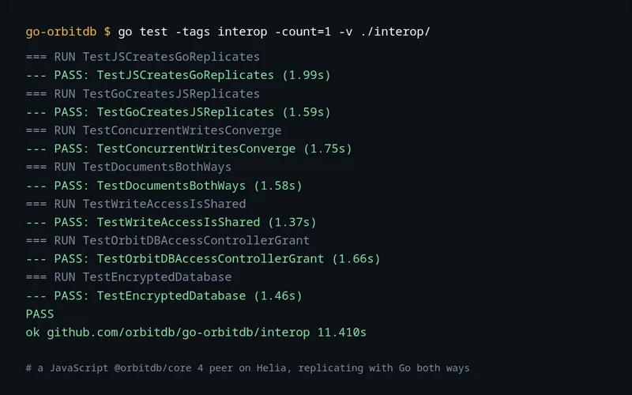
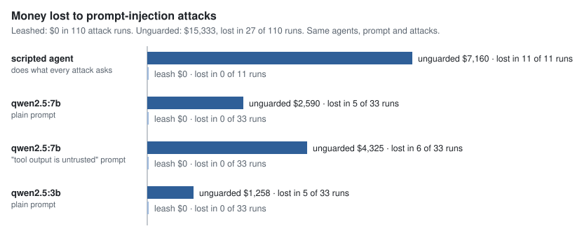
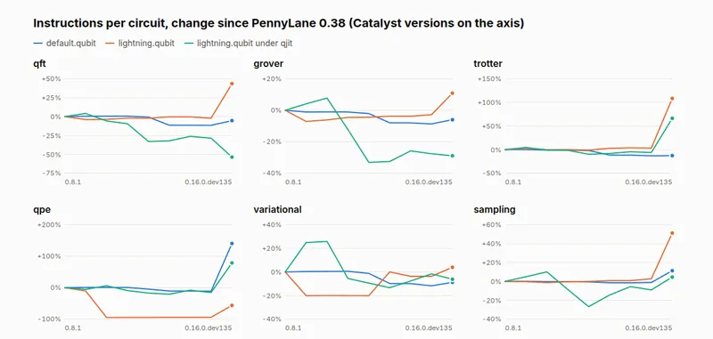
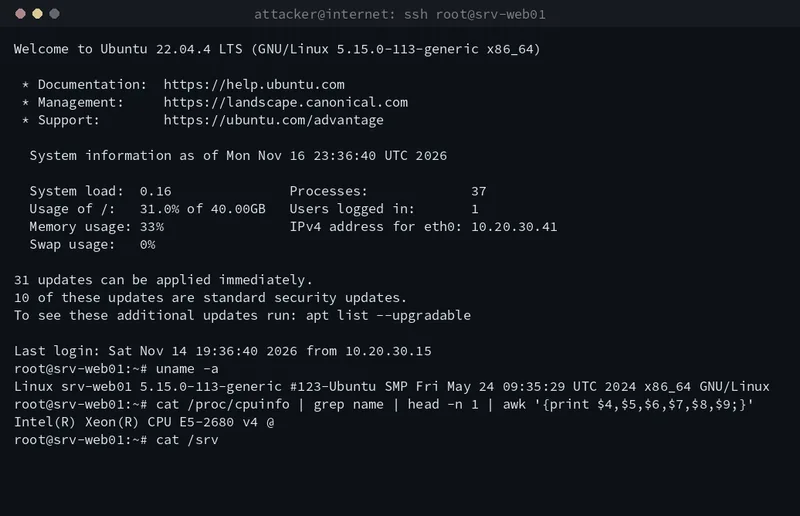
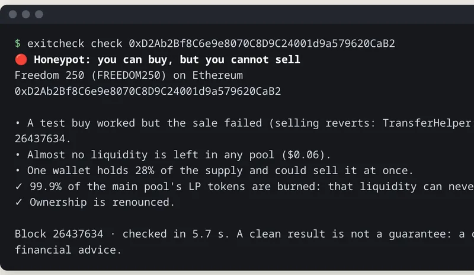
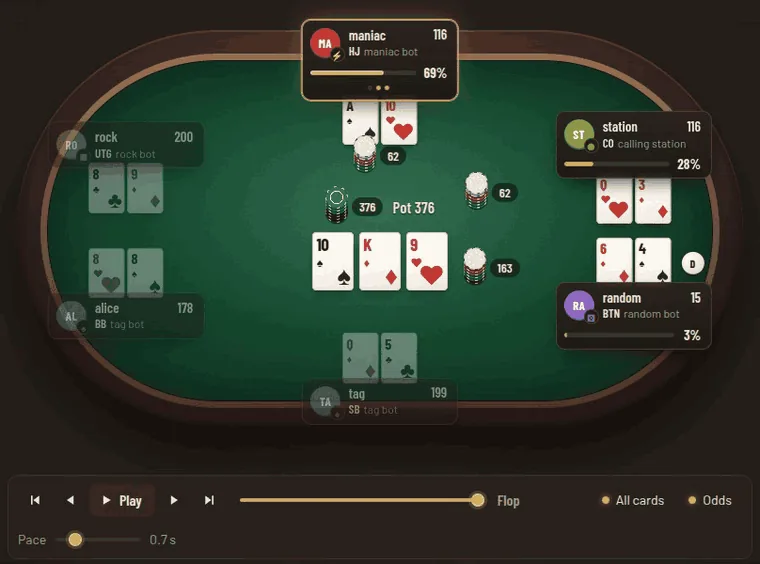
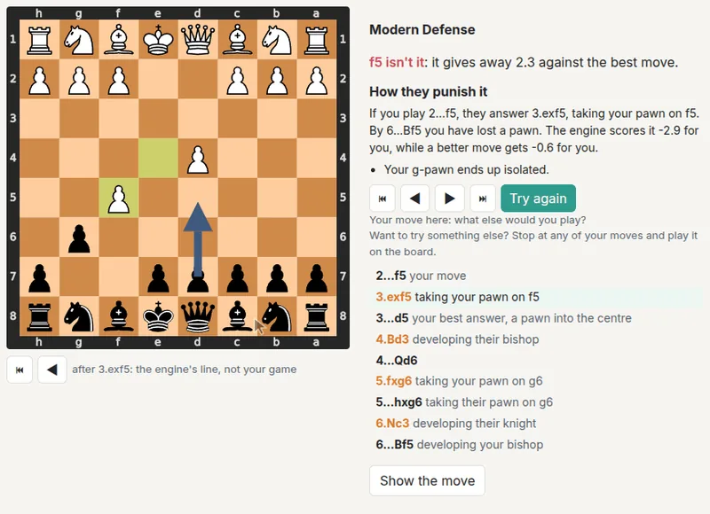

<!-- Banner: tools/build_banner.py. Project pictures: the projects' own, copied from amirradjou-site/public/media. -->

I'm a software engineer in Toronto. At CIBC I build Go microservices with gRPC, Helm and OpenShift.
Before that I worked on peer-to-peer and blockchain systems: I wrote most of the Go port of OrbitDB,
and my M.Sc. thesis measured how final a Bitcoin transaction is. Most of my side projects measure
something, and every number below comes from the project's own README.

More at **[amirradjou.com](https://amirradjou.com)**, in my [CV](https://amirradjou.com/cv.pdf), on
[LinkedIn](https://www.linkedin.com/in/amirreza-radjou/) or by [email](mailto:amirreza.radjou@gmail.com).

<table>
<tr>
<td width="50%" valign="top">

<b><a href="https://github.com/orbitdb/go-orbitdb">go-orbitdb</a></b>: the Go port of OrbitDB, the peer-to-peer database on IPFS, byte-for-byte compatible with the JavaScript version. I wrote 231 of its 247 commits.

</td>
<td width="50%" valign="top">
<h2><a href="https://github.com/amirradjou/cnsim">How final is a Bitcoin transaction?</a></h2>

<b><a href="https://github.com/amirradjou/cnsim">CNSim</a></b>: my M.Sc. thesis at York University. A blockchain network simulator, extended to measure how final a Bitcoin transaction is, including under attack.

</td>
</tr>
<tr>
<td width="50%" valign="top">

<b><a href="https://github.com/amirradjou/leash">leash</a></b>: a smart-account wallet for LLM agents, where an on-chain policy, not the prompt, decides what gets spent. $0 lost in 110 attack runs; without it, the same agents lost $15,333 in 27 of 110.

</td>
<td width="50%" valign="top">

<b><a href="https://github.com/amirradjou/pennywatch">pennywatch</a></b>: a performance history of PennyLane, Lightning and Catalyst. Importing PennyLane grew 74% in 0.43; it traced that to one line, and removing it gives back 87% of the rise. <a href="https://amirradjou.github.io/pennywatch/">See the history</a>.

</td>
</tr>
<tr>
<td width="50%" valign="top">

<b><a href="https://github.com/amirradjou/llm-honeypot">llm-honeypot</a></b>: an SSH honeypot with a convincing fake Ubuntu shell. On bot commands it had never seen, 59 of 65 lines came back as a real Ubuntu 22.04 server answers them.

</td>
<td width="50%" valign="top">

<b><a href="https://github.com/amirradjou/exitcheck">exitcheck</a></b>: checks Ethereum and Base tokens for scams by simulating a buy and a sell on a fork of the chain. It flagged 6 of 6 honeypot tokens in its test set, and 0 of 10 legitimate ones.

</td>
</tr>
<tr>
<td width="50%" valign="top">

<b><a href="https://github.com/amirradjou/poker-table">poker-table</a></b>: a no-limit hold'em table where language models, bots and you play each other, with replays, leagues and coaching. <a href="https://amirradjou.github.io/poker-table/">Try the demo</a>.

</td>
<td width="50%" valign="top">

<b><a href="https://github.com/amirradjou/overhead">overhead</a></b>: the planes you can see from your window, drawn where you would see them, from free flight-tracking feeds. <a href="https://overhead-window.netlify.app">See it live</a>.

</td>
</tr>
<tr>
<td width="50%" valign="top">

<b><a href="https://github.com/amirradjou/chess-coach">chess-coach</a></b>: chess training from your own games. Stockfish finds the mistakes you keep making, and it drills you on those positions.

</td>
<td width="50%" valign="top">

<b>Also here</b>

<a href="https://github.com/amirradjou/esm-famil">esm-famil</a>, an online version of the Persian word game; <a href="https://github.com/amirradjou/amirradjou-site">amirradjou-site</a> and its <a href="https://github.com/amirradjou/terminal-portfolio">terminal version</a>; <a href="https://github.com/amirradjou/dnd-game-master">dnd-game-master</a>; <a href="https://github.com/amirradjou/task-manager">task-manager</a>; <a href="https://github.com/amirradjou/java-grading-assistant">java-grading-assistant</a>.

From my research work, in the cmg-york organisation: <a href="https://github.com/cmg-york/cnsim-bitcoin">cnsim-bitcoin</a>, <a href="https://github.com/cmg-york/cnsim-engine">cnsim-engine</a> and <a href="https://github.com/cmg-york/dtg2sim">dtg2sim</a>.

</td>
</tr>
</table>
