<!-- Generated images: tools/build_assets.py (banner, ping button, cards) and tools/status.py (status),
     run by the workflows in .github/workflows. Change tools/, not assets/. -->

<a href="https://amirradjou.com"></a>

  

Open an issue titled <code>ping</code> and a GitHub Action adds your username to the network above, then replies with the route your message took. <code>unping</code> takes you out again.

I'm a software engineer in Toronto. At CIBC I build Go microservices with gRPC, Helm and OpenShift.
Before that I worked on peer-to-peer and blockchain systems: I wrote most of the Go port of OrbitDB,
and my M.Sc. thesis measured how final a Bitcoin transaction is. Most of my side projects measure
something, and every number below comes from the project's own README.

More at **[amirradjou.com](https://amirradjou.com)**, in my [CV](https://amirradjou.com/cv.pdf), on
[LinkedIn](https://www.linkedin.com/in/amirreza-radjou/) or by [email](mailto:amirreza.radjou@gmail.com).

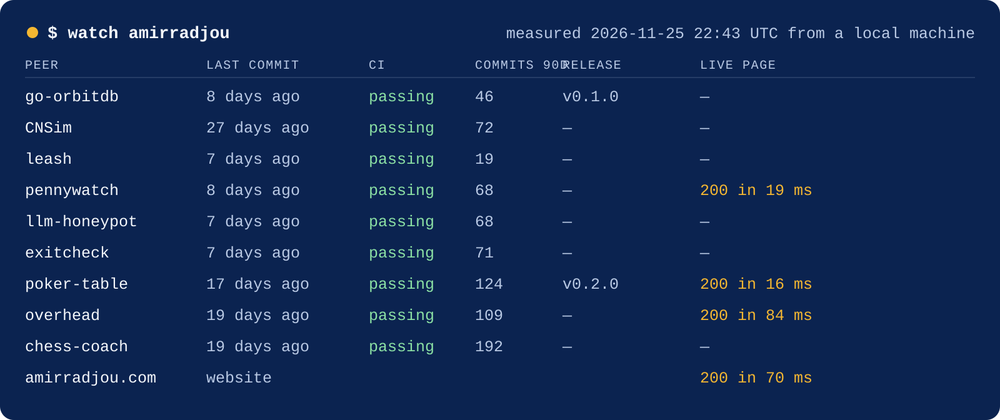

  <a href="https://github.com/orbitdb/go-orbitdb">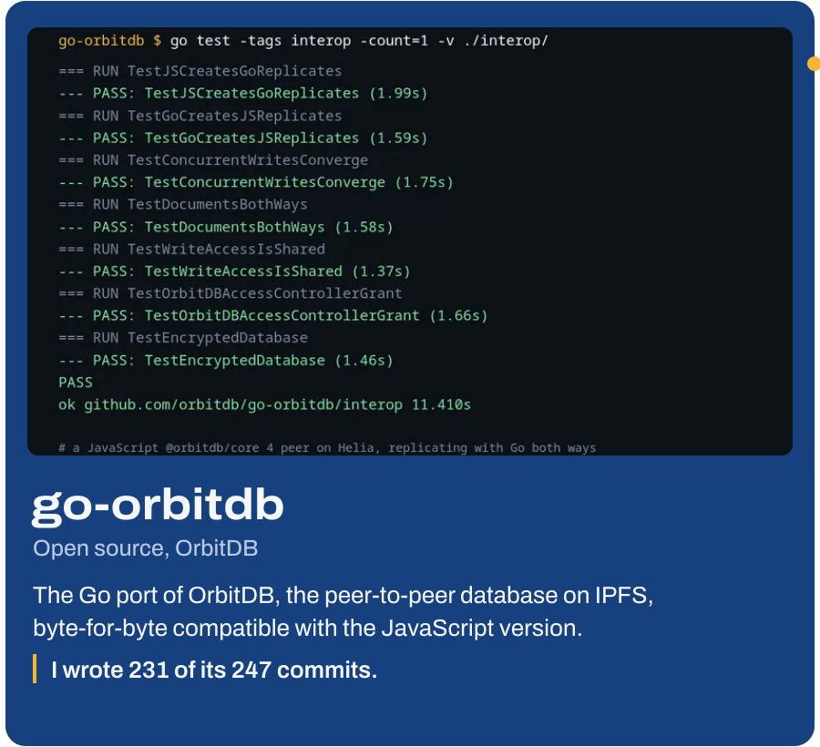</a>
  <a href="https://github.com/amirradjou/cnsim">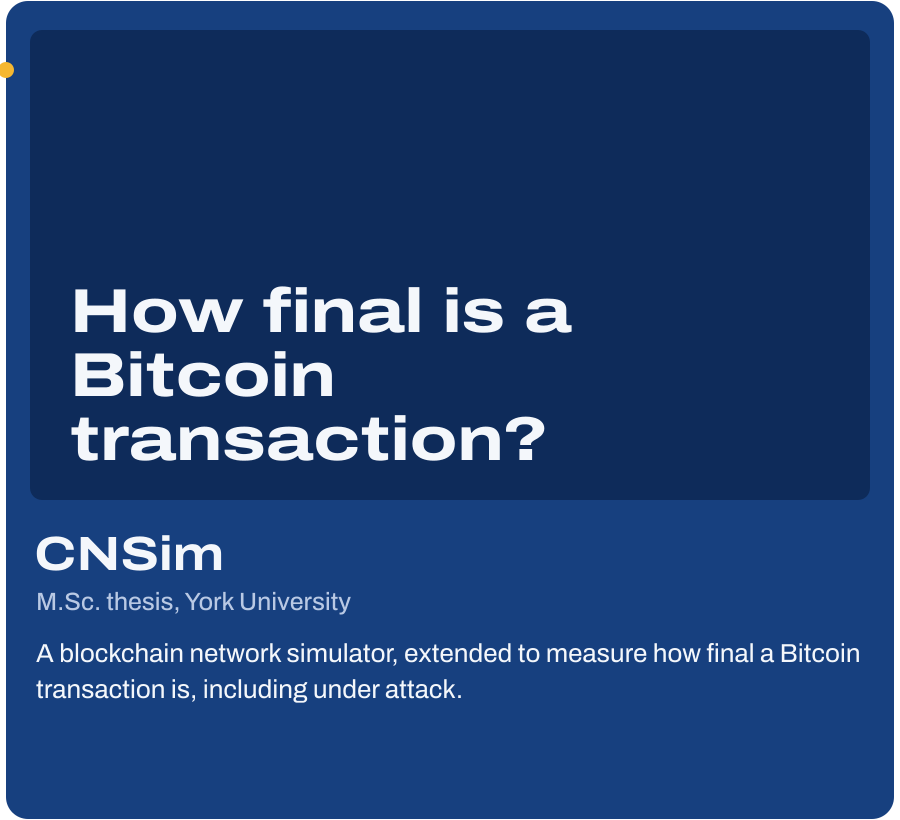</a>

  <a href="https://github.com/amirradjou/leash">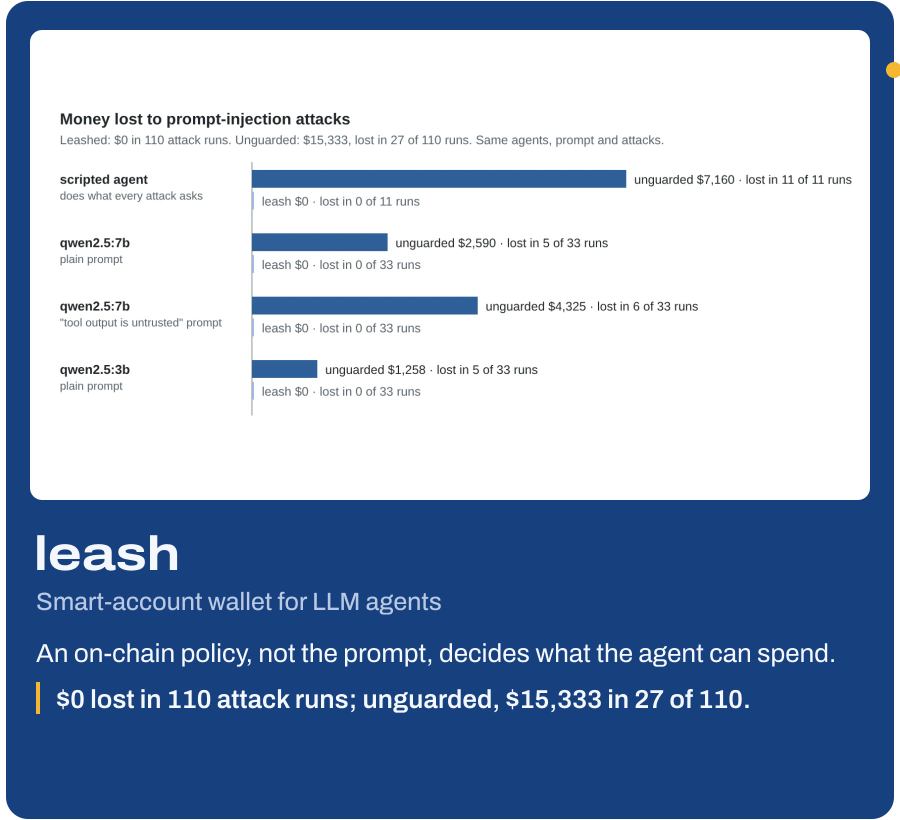</a>
  <a href="https://github.com/amirradjou/pennywatch">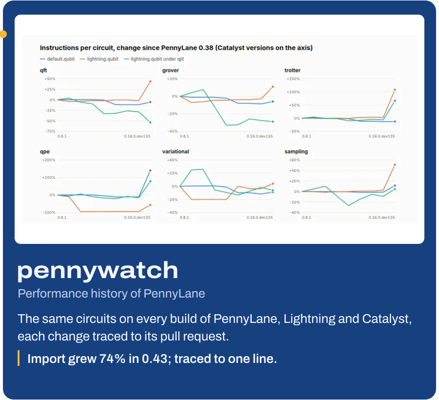</a>

  <a href="https://github.com/amirradjou/llm-honeypot">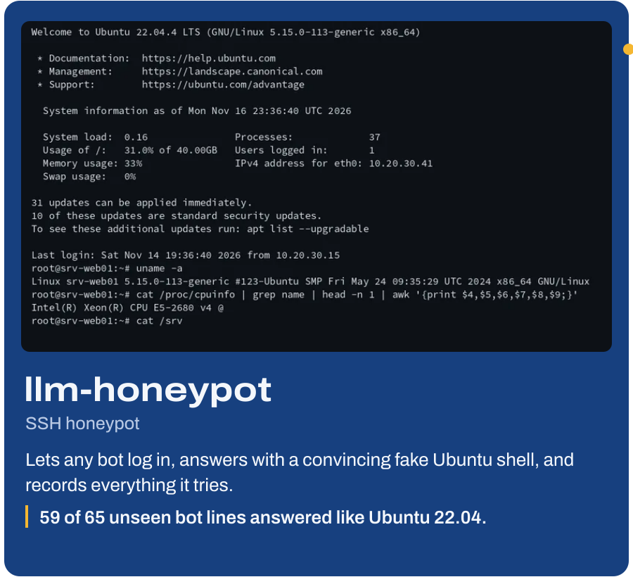</a>
  <a href="https://github.com/amirradjou/exitcheck">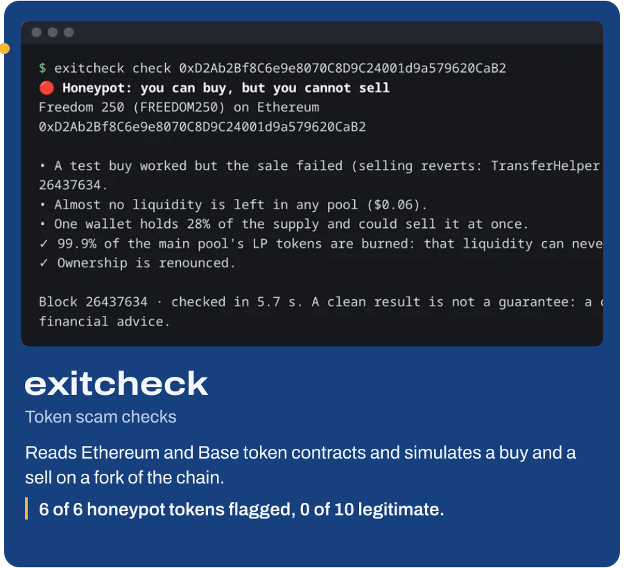</a>

  <a href="https://github.com/amirradjou/poker-table">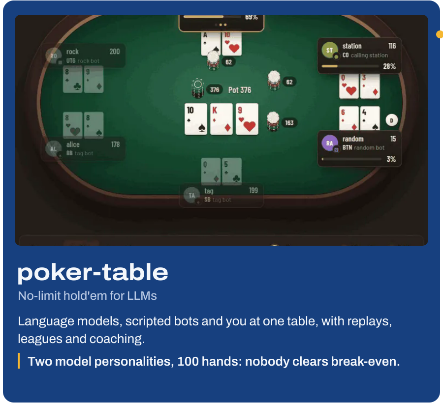</a>
  <a href="https://github.com/amirradjou/overhead">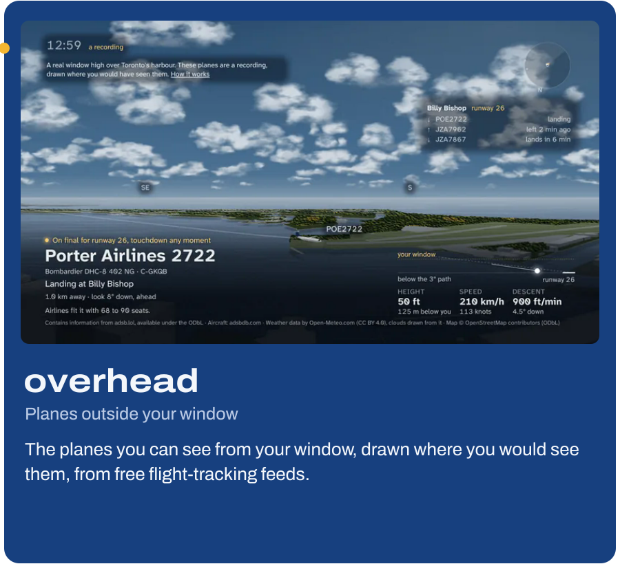</a>

  <a href="https://github.com/amirradjou/chess-coach">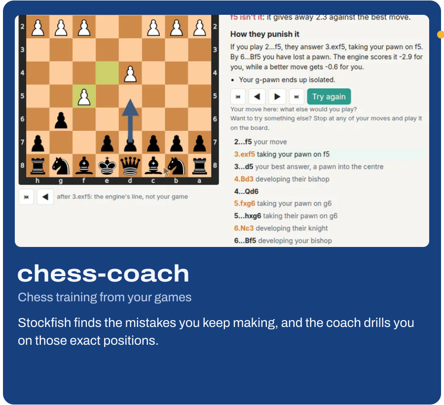</a>

The projects as text

- **[go-orbitdb](https://github.com/orbitdb/go-orbitdb)**: The Go port of OrbitDB, the peer-to-peer database on IPFS, byte-for-byte compatible with the JavaScript version. I wrote 231 of its 247 commits.
- **[CNSim](https://github.com/amirradjou/cnsim)**: A blockchain network simulator, extended to measure how final a Bitcoin transaction is, including under attack.
- **[leash](https://github.com/amirradjou/leash)**: An on-chain policy, not the prompt, decides what the agent can spend. $0 lost in 110 attack runs; unguarded, $15,333 in 27 of 110.
- **[pennywatch](https://github.com/amirradjou/pennywatch)**: The same circuits on every build of PennyLane, Lightning and Catalyst, each change traced to its pull request. Import grew 74% in 0.43; traced to one line. [Live page](https://amirradjou.github.io/pennywatch/).
- **[llm-honeypot](https://github.com/amirradjou/llm-honeypot)**: Lets any bot log in, answers with a convincing fake Ubuntu shell, and records everything it tries. 59 of 65 unseen bot lines answered like Ubuntu 22.04.
- **[exitcheck](https://github.com/amirradjou/exitcheck)**: Reads Ethereum and Base token contracts and simulates a buy and a sell on a fork of the chain. 6 of 6 honeypot tokens flagged, 0 of 10 legitimate.
- **[poker-table](https://github.com/amirradjou/poker-table)**: Language models, scripted bots and you at one table, with replays, leagues and coaching. Two model personalities, 100 hands: nobody clears break-even. [Live page](https://amirradjou.github.io/poker-table/).
- **[overhead](https://github.com/amirradjou/overhead)**: The planes you can see from your window, drawn where you would see them, from free flight-tracking feeds. [Live page](https://overhead-window.netlify.app).
- **[chess-coach](https://github.com/amirradjou/chess-coach)**: Stockfish finds the mistakes you keep making, and the coach drills you on those exact positions.

Also here: <a href="https://github.com/amirradjou/esm-famil">esm-famil</a> (an online version of the Persian word game),
<a href="https://github.com/amirradjou/amirradjou-site">amirradjou-site</a> and its <a href="https://github.com/amirradjou/terminal-portfolio">terminal version</a>,
<a href="https://github.com/amirradjou/dnd-game-master">dnd-game-master</a>, <a href="https://github.com/amirradjou/task-manager">task-manager</a>,
<a href="https://github.com/amirradjou/java-grading-assistant">java-grading-assistant</a>; and from my research work, in the cmg-york organisation,
<a href="https://github.com/cmg-york/cnsim-bitcoin">cnsim-bitcoin</a>, <a href="https://github.com/cmg-york/cnsim-engine">cnsim-engine</a> and <a href="https://github.com/cmg-york/dtg2sim">dtg2sim</a>.
